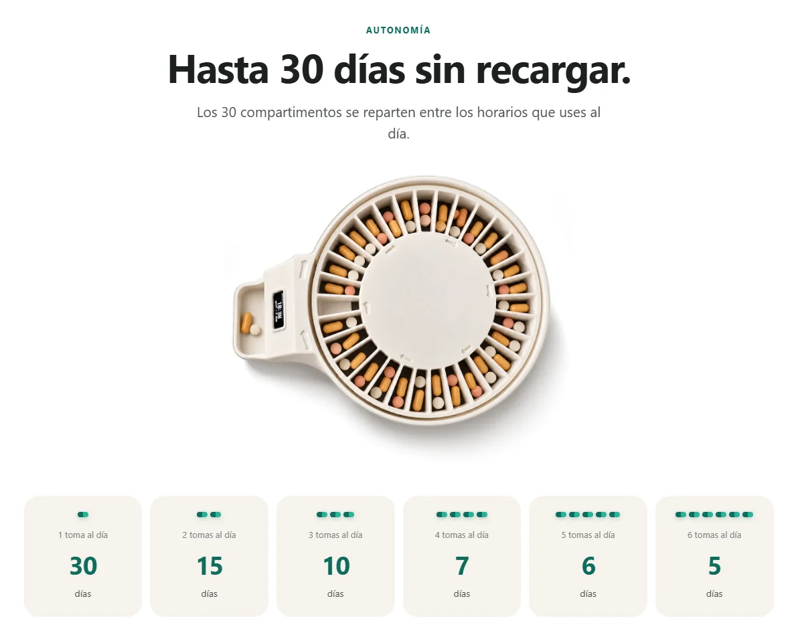
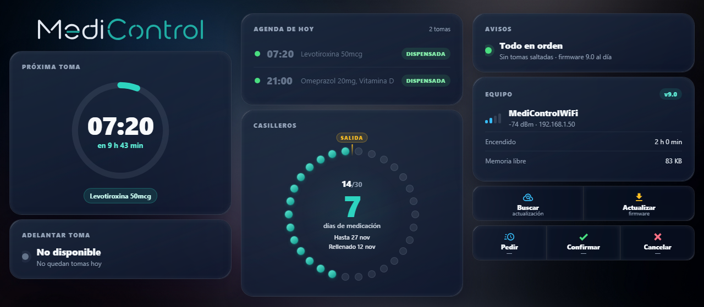
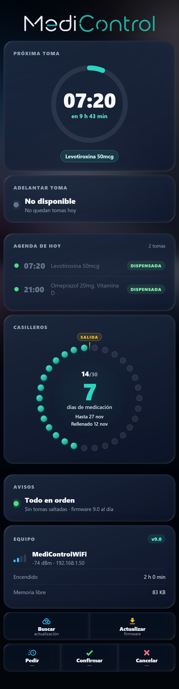

  

  

  
  
  
  

  
  

# MediControl para Home Assistant

Panel, automatizaciones y guía para ver y controlar tu pastillero **MediControl** desde Home Assistant.

MediControl es un pastillero automático con 30 compartimentos y hasta 6 tomas al día. Dispensa cada toma a su hora con aviso sonoro y funciona sin Internet. Si lo conectas a Home Assistant, puedes verlo todo en un panel, adelantar una toma desde el móvil y crear tus propias automatizaciones.

**Necesitas un pastillero MediControl.** Puedes comprarlo en [medi-control.es](https://medi-control.es/comprar.php).

  

## Qué incluye este repositorio

| Archivo | Para qué sirve |
|---|---|
| [`dashboard/medicontrol-panel.yaml`](dashboard/medicontrol-panel.yaml) | El panel de las capturas: próxima toma, agenda del día, casilleros, avisos, estado del equipo y botones. |
| [`automations/adelanto-movil.yaml`](automations/adelanto-movil.yaml) | Aviso en el móvil para confirmar o cancelar cuando se pide adelantar una toma. |

## 1. Conectar el pastillero a Home Assistant

No hace falta instalar ninguna integración: el pastillero aparece solo en Home Assistant mediante MQTT.

1. Instala un broker MQTT, por ejemplo el complemento **Mosquitto broker**, y crea un usuario para el pastillero.
2. En Home Assistant, añade la integración **MQTT** en **Ajustes > Dispositivos y servicios** y deja activado el descubrimiento.
3. En la web del pastillero, entra en **Home Assistant**, escribe la IP del broker, el usuario y la contraseña, y pulsa **Conectar**.
4. En unos segundos aparece el dispositivo **MediControl** en la integración MQTT, con todos sus sensores y botones.

> Recomendado: en **Ajustes > Dispositivos y servicios > MQTT**, abre el dispositivo, cámbiale el nombre a `MediControl` y acepta cuando Home Assistant pregunte si quieres **cambiar también los ID de las entidades**. Así tus sensores se llamarán `sensor.medicontrol_...` y te resultará más fácil usar el panel.

## 2. Qué aparece en Home Assistant

Los nombres de la tabla son los que tendrás si renombras el dispositivo a `MediControl` como se recomienda arriba.

**Tratamiento**

| Entidad | Qué muestra |
|---|---|
| `sensor.medicontrol_proxima_toma` | Hora de la próxima toma |
| `sensor.medicontrol_proximos_medicamentos` | Medicamentos de la próxima toma |
| `sensor.medicontrol_horarios_y_medicamentos` | Todas las tomas del día con sus medicamentos |
| `sensor.medicontrol_horarios_por_dia` | Cuántas tomas hay configuradas al día |
| `sensor.medicontrol_dias_restantes` | Días de medicación que quedan |
| `sensor.medicontrol_medicamentos_hasta` | Fecha hasta la que alcanza la carga |
| `sensor.medicontrol_ultimo_rellenado` | Fecha y hora del último rellenado |
| `sensor.medicontrol_compartimento_actual` | Compartimento en el que está el carrusel |
| `sensor.medicontrol_compartimentos_restantes` | Compartimentos con medicación por dispensar |
| `sensor.medicontrol_compartimentos_maximos` | Compartimentos totales disponibles |
| `sensor.medicontrol_adelanto_de_toma` | Estado del adelanto: qué toma se puede adelantar, cuál espera confirmación o por qué no se puede |
| `sensor.medicontrol_tomas_saltadas` | Tomas que no se dispensaron porque el equipo estaba apagado |

**Estado del equipo**

| Entidad | Qué muestra |
|---|---|
| `sensor.medicontrol_wifi` | Red WiFi a la que está conectado |
| `sensor.medicontrol_rssi` | Intensidad de la señal WiFi (dBm) |
| `sensor.medicontrol_ip` | Dirección IP del pastillero en tu red |
| `sensor.medicontrol_memoria` | Memoria libre (KB) |
| `sensor.medicontrol_uptime` | Tiempo encendido (segundos) |
| `sensor.medicontrol_firmware` | Versión de firmware instalada |
| `sensor.medicontrol_actualizacion` | Si hay una actualización disponible |

**Botones**

| Entidad | Qué hace |
|---|---|
| `button.medicontrol_pedir_adelantar_la_proxima_toma` | Pide adelantar la próxima toma del día |
| `button.medicontrol_confirmar_adelanto_de_toma` | Confirma el adelanto y dispensa (en menos de 2 minutos) |
| `button.medicontrol_cancelar_adelanto_de_toma` | Anula la petición de adelanto |
| `button.medicontrol_buscar_actualizacion` | Comprueba si hay firmware nuevo |
| `button.medicontrol_instalar_actualizacion` | Instala la actualización disponible |

Lo que el pastillero envía a Home Assistant se queda en tu red: va directo a tu broker MQTT, sin pasar por ningún servidor externo.

## 3. Instalar el panel

1. Instala estas dos tarjetas de la comunidad: **button-card** y **card-mod**. Cómo se hace depende de tu versión de Home Assistant (la ves en **Ajustes > Información**):
   - **Home Assistant 2026.11 o posterior:** ve a **Ajustes > Marketplace**, busca cada tarjeta y pulsa **Instalar**. No hace falta instalar nada más ni tener cuenta de GitHub.
   - **Versiones anteriores:** se instalan desde **HACS**, la tienda de la comunidad, que hay que añadir aparte siguiendo la [guía oficial de HACS](https://www.hacs.xyz/docs/use/download/download/). Después, en **HACS**, busca cada tarjeta y pulsa **Descargar**.

   Después de instalarlas, recarga el navegador (o cierra y abre la app) para que el panel las reconozca.
2. Averigua el identificador de tu pastillero: busca en **Ajustes > Entidades** el sensor «Próxima toma». Si se llama `sensor.medicontrol_proxima_toma`, tu identificador es `medicontrol`.
3. Abre [`dashboard/medicontrol-panel.yaml`](dashboard/medicontrol-panel.yaml) y sustituye todas las apariciones de `TU_EQUIPO` por tu identificador. Cualquier editor de texto lo hace con «Buscar y reemplazar».
4. En Home Assistant ve a **Ajustes > Paneles > Añadir panel**, créalo y ábrelo.
5. Pulsa el lápiz, luego los tres puntos y **Editor de configuración en bruto**. Pega el contenido dentro de `views:` y guarda.

El panel está pensado para una tableta en horizontal (tres columnas) y se adapta al móvil en una sola columna. Los botones **Confirmar** y **Actualizar** piden confirmación antes de actuar.

 

## 4. Adelantar una toma desde el móvil

Desde el firmware 9.1 puedes dispensar antes de hora la próxima toma del día. Siempre se hace en dos pasos: **pedir** y **confirmar** en menos de 2 minutos. Mientras tanto, la pantalla del pastillero muestra «ADELANTAR TOMA» con la hora.

- Solo se puede adelantar la siguiente toma del mismo día, sin saltar ninguna, y una sola a la vez.
- La toma adelantada cuenta como dada: a su hora el pastillero ya no gira, aunque se reinicie.
- Queda registrada en el historial del equipo y, si tienes activados los avisos por correo, recibes un correo indicando que se adelantó.

Con las automatizaciones de [`automations/adelanto-movil.yaml`](automations/adelanto-movil.yaml), al pulsar **Pedir** te llega un aviso al móvil con los botones **Confirmar** y **Cancelar**. Sustituye `TU_EQUIPO` y `TU_MOVIL` (el nombre de tu móvil en la app de Home Assistant: `notify.mobile_app_TU_MOVIL`) y crea cada automatización desde **Ajustes > Automatizaciones > Editar en YAML**.

## Si algo no aparece

- **El dispositivo no aparece:** comprueba en la web del pastillero que la conexión MQTT está verificada y que el descubrimiento MQTT está activado en Home Assistant.
- **El panel muestra «Sin datos»:** revisa que has sustituido `TU_EQUIPO` en todo el archivo y que los nombres de tus sensores coinciden.
- **Un equipo antiguo tiene otros nombres de sensores:** en equipos configurados con firmwares anteriores, algunos sensores pueden conservar su nombre original (por ejemplo `proximo_medicamento` en lugar de `proxima_toma`). Cámbiales el ID en **Ajustes > Entidades** o ajústalo en el panel.
- **Faltan los botones de adelanto o el sensor de tomas saltadas:** actualiza el pastillero a la última versión desde su web o desde el botón **Actualizar** del panel.

## Homey y Homey Pro

MediControl habla MQTT, el mismo idioma que usa con Home Assistant, así que también se puede conectar a **Homey Pro**. Ten en cuenta que:

- **Homey Pro sí puede**, instalando apps de la comunidad para MQTT.
- **Homey (la versión en la nube, sin el aparato Homey Pro), en principio no:** las apps de MQTT son de la comunidad y funcionan en Homey Pro. Antes de comprar nada, comprueba en la tienda de apps de Homey si están disponibles para tu modelo.
- En Homey no hay un panel como el de Home Assistant: el pastillero se usa a través de **Flows** (automatizaciones).

> Esta parte no la hemos probado nosotros con un Homey Pro. Los pasos se basan en cómo funcionan las apps MQTT de Homey; si algo no coincide, escríbenos desde tu área de cliente.

**Pasos en Homey Pro**

1. Necesitas un broker MQTT: instala en Homey Pro la app **MQTT Broker**, o usa uno que ya tengas en otro equipo de tu red.
2. Instala la app **MQTT Client** y conéctala a ese broker.
3. En la web del pastillero, entra en **Home Assistant** (es la misma pantalla para cualquier broker MQTT), escribe la IP del broker (la de tu Homey Pro si usas su app), el usuario y la contraseña, y pulsa **Conectar**.
4. Crea los Flows que quieras con estos canales. `ID` es el identificador de tu pastillero, del tipo `medicontrol-a1b2c3d4e5f6`; lo verás en los mensajes que llegan al broker.

| Canal MQTT | Qué contiene |
|---|---|
| `medicontrol/ID/medicamentos` | JSON con la próxima toma (`proximoHora`, `proximoMedicamentos`), `diasRestantes`, `compartimentosRestantes`, `fechaFin` y más. |
| `medicontrol/ID/adelanto` | JSON con el adelanto: `texto`, `pendiente`, `adelantada`, `proxima_adelantable` y `motivo`. |
| `medicontrol/ID/saltadas` | JSON con `cantidad`: tomas que no se dispensaron por estar apagado. |
| `medicontrol/ID/sensors` | JSON con el estado del equipo: WiFi, señal, IP, memoria y firmware. |
| `medicontrol/ID/availability` | `online` u `offline`. |

Para **dar órdenes**, publica el mensaje `1` en uno de estos canales:

| Canal | Acción |
|---|---|
| `medicontrol/ID/cmd/adelanto_pedir` | Pedir adelantar la próxima toma |
| `medicontrol/ID/cmd/adelanto_confirmar` | Confirmar el adelanto (en menos de 2 minutos) |
| `medicontrol/ID/cmd/adelanto_cancelar` | Cancelar el adelanto |

Ejemplo de Flow: **Cuando** llega un mensaje en `medicontrol/ID/adelanto` cuyo `pendiente` no está vacío, **entonces** envía una notificación al móvil con la hora. Y un segundo Flow con un botón virtual que publique `1` en `medicontrol/ID/cmd/adelanto_confirmar`.

## Enlaces

- Web: [medi-control.es](https://medi-control.es)
- Comprar: [medi-control.es/comprar.php](https://medi-control.es/comprar.php)
- Instagram: [@medi_control.es](https://instagram.com/medi_control.es)
- Soporte: desde tu área de cliente en [medi-control.es](https://medi-control.es)

---

MediControl es un producto de [Medi-Control.es](https://medi-control.es), desarrollado por NeoDesarrollos.
